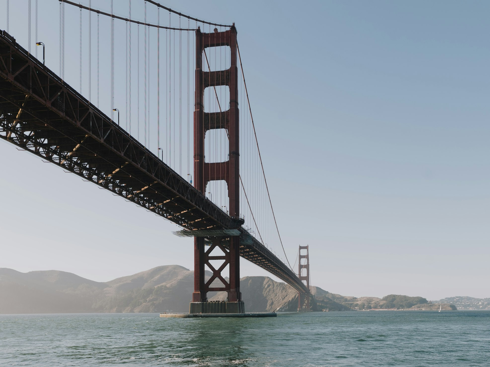
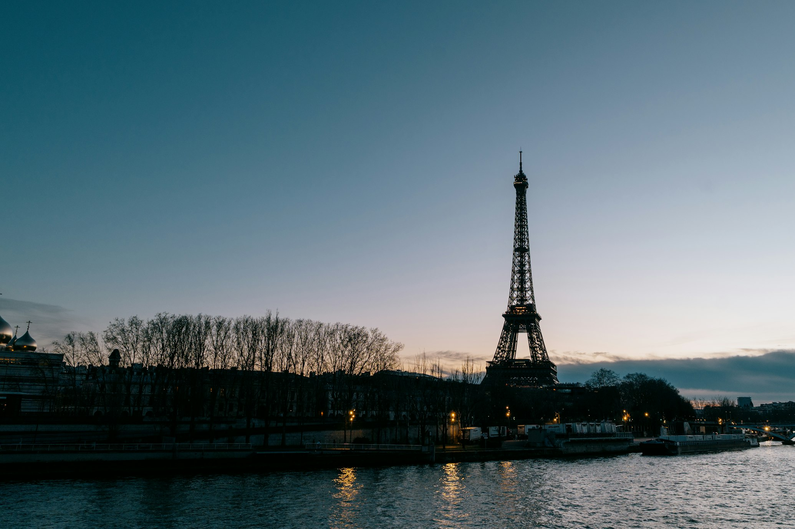
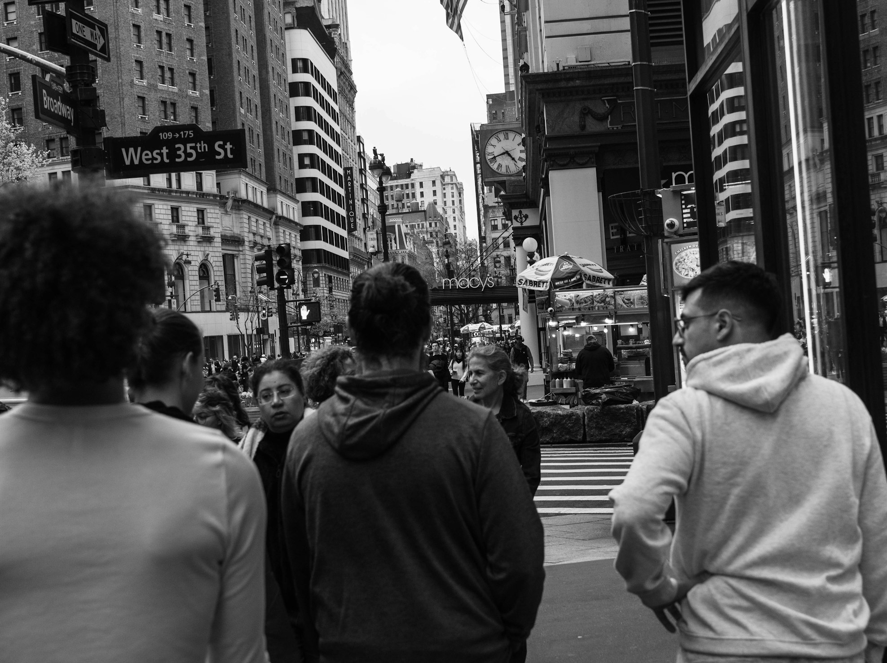
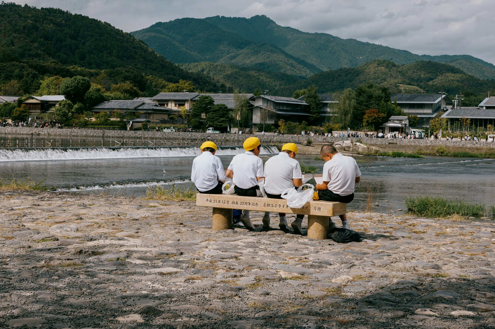
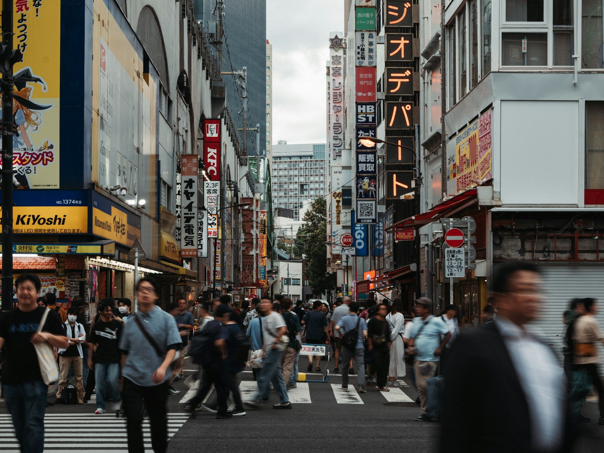
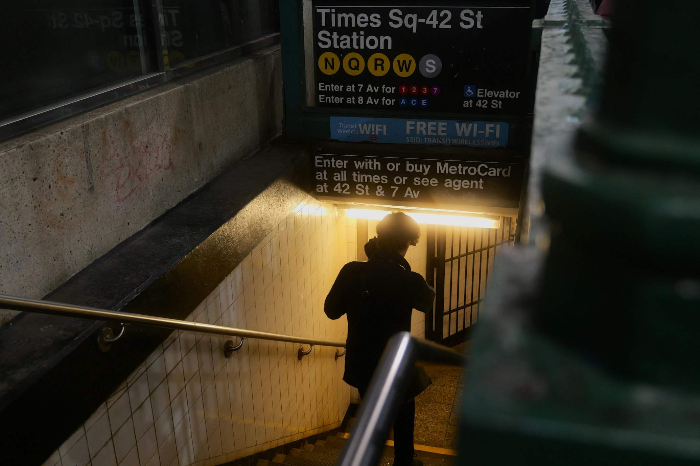
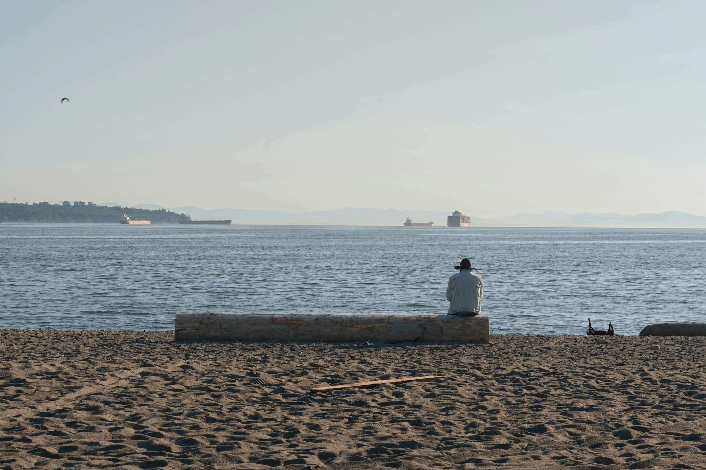
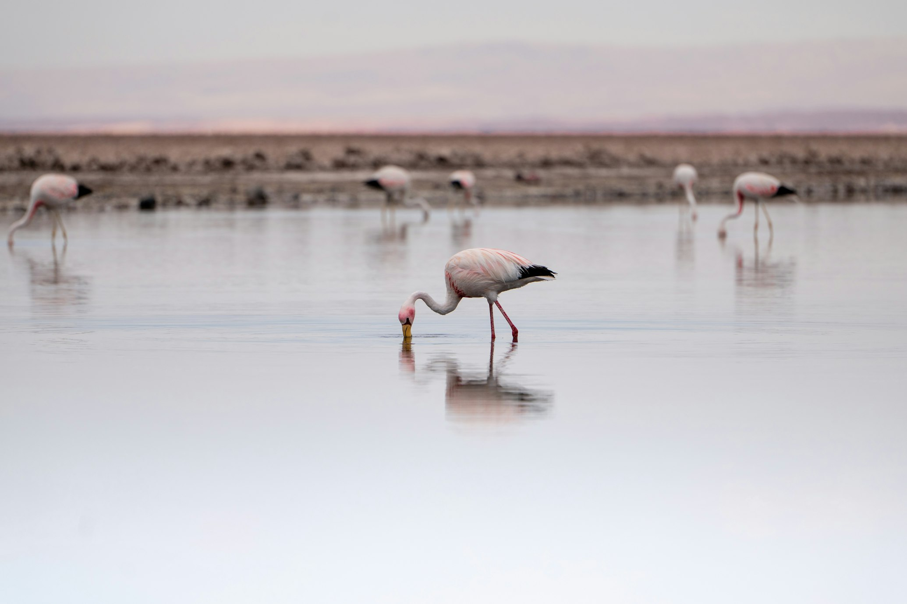

Travel is a big part of my life, and since my wife and I both work remotely, we spend a lot of time away from home. In 2022, we packed everything into two carry-ons and spent a year traveling.

We have a home base again now, but that year changed the way we travel. These days, we prefer slow travel, usually spending at least a month in each destination.

Traveling always gives me a new perspective. I remember landing in Tokyo for the first time and seeing all these people just living their lives, people I had never even thought about before. It’s a feeling I’ll probably never have in quite the same way again, like watching a movie for the first time.

## 2026

- Nagoya (Japan)
- Takayama (Japan)
- Kanazawa (Japan)
- Tokyo (Japan)
- Grafton, UT (USA)
- Bryce Canyon National Park, UT (USA)
- Kanab, UT (USA)
- Zion National Park, UT (USA)
- Springdale, UT (USA)
- St. George, UT (USA)
- Las Vegas, NV (USA)
- Berkeley, CA (USA)
- San Francisco, CA (USA)
  
  
- Paris (France)
  
  
- Lyon (France)
- Villeurbanne (France)
- Brussels (Belgium)
- Bruges (Belgium)

## 2025

- Kilkenny (Ireland)
- New York, NY (USA)
  
  
- San Francisco, CA (USA)
- Santa Monica, CA (USA)
- Los Angeles, CA (USA)
- Houston, TX (USA)
- Miyajima (Japan)
- Hiroshima (Japan)
  
  
- Osaka (Japan)
- Nara (Japan)
- Kyoto (Japan)
  
  
- Hakone (Japan)
- Tokyo (Japan)
  
  
- Santa Cruz, CA (USA)
- Half Moon Bay, CA (USA)
- Walnut Creek, CA (USA)
- Mountain View, CA (USA)
- Colônia Witmarsum, PR (Brazil)
- Ponta Grossa, PR (Brazil)
- Rio de Janeiro, RJ (Brazil)
- Bombinhas, SC (Brazil)
- Miami, FL (USA)
- Chicago, IL (USA)
- St. Paul, MN (USA)
- Minneapolis, MN (USA)
- Washington, D.C. (USA)

## 2024

- New York, NY (USA)
  
  
- Porto (Portugal)
- Amsterdam (Netherlands)
- Kilkenny (Ireland)
- Dublin (Ireland)
- Vancouver, BC (Canada)
  
  
- Toronto, ON (Canada)
- Montreal, QC (Canada)
- San Pedro de Atacama (Chile)
  
  
- Santiago (Chile)
- Arlington, VA (USA)
- Washington, D.C. (USA)
- Philadelphia, PA (USA)
  
  

## 2023

- Jersey City, NJ (USA)
- Hoboken, NJ (USA)
- New York, NY (USA)
- Dublin (Ireland)
- Londonderry (Northern Ireland)
- Belfast (Northern Ireland)
- Kearny, NJ (USA)
- Kilkenny (Ireland)
- London (England)
- Dubrovnik (Croatia)
- Split (Croatia)
- Zagreb (Croatia)
- Cascais (Portugal)
- Sintra (Portugal)
- Lisbon (Portugal)
- Rio de Janeiro, RJ (Brazil)
- Aracaju, SE (Brazil)
- João Pessoa, PB (Brazil)
- São Paulo, SP (Brazil)
- São Luiz do Purunã, PR (Brazil)
- Joinville, SC (Brazil)

## 2022

- Vienna (Austria)
- Venice (Italy)
- Florence (Italy)
- Vatican City (Vatican City)
- Rome (Italy)
- Whistler, BC (Canada)
- Victoria, BC (Canada)
- Vancouver, BC (Canada)
- Calgary, AB (Canada)
- Banff National Park, AB (Canada)
- Ribeirão Claro, PR (Brazil)
- Foz do Iguaçu, PR (Brazil)
- Buenos Aires (Argentina)
- London (England)
- Protaras (Cyprus)
- Paphos (Cyprus)
- Limassol (Cyprus)
- Ayia Napa (Cyprus)
- Limerick (Ireland)
- Galway (Ireland)
- Dublin (Ireland)
- Cork (Ireland)
- Cobh (Ireland)
- Miami, FL (USA)
- Orlando, FL (USA)

## 2021

- Punta Cana (Dominican Republic)
- Brasília, DF (Brazil)
- Carambeí, PR (Brazil)
- Natal, RN (Brazil)
- Rio de Janeiro, RJ (Brazil)
- Morretes, PR (Brazil)
- Foz do Iguaçu, PR (Brazil)
